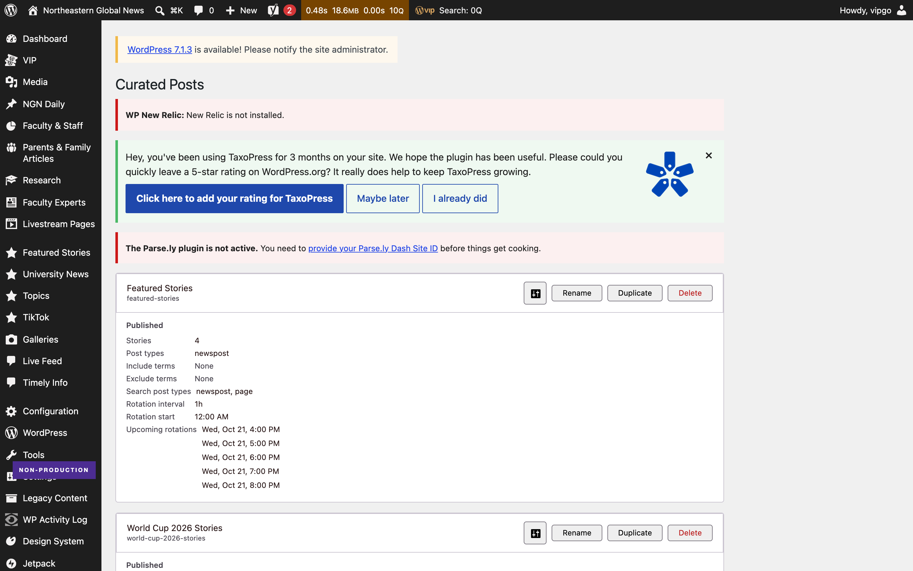
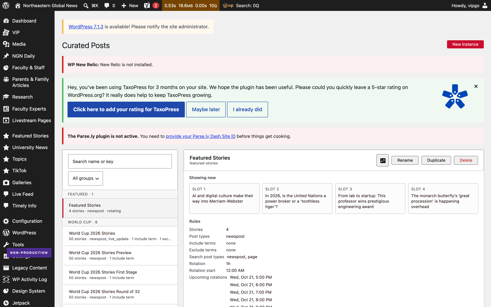
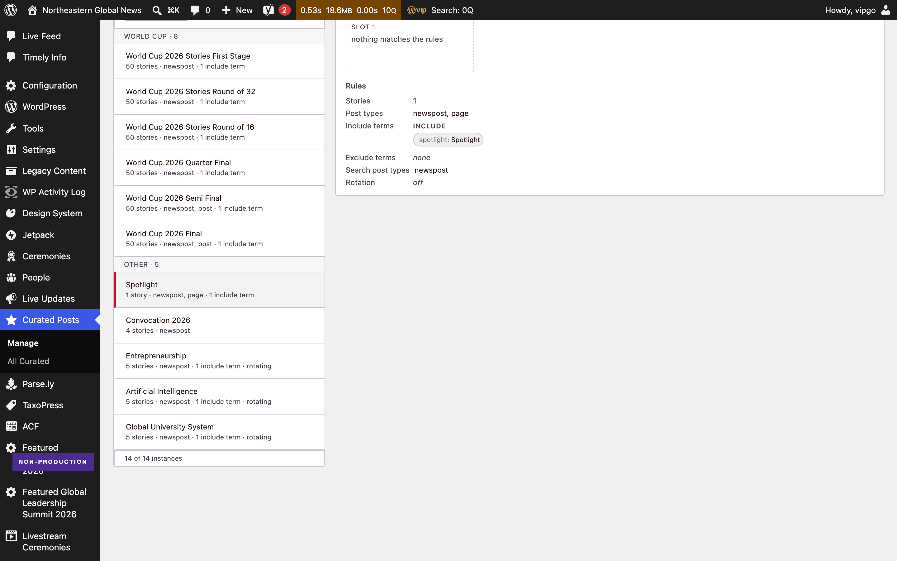
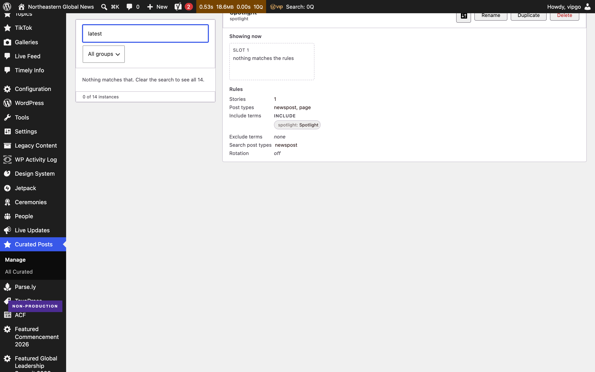
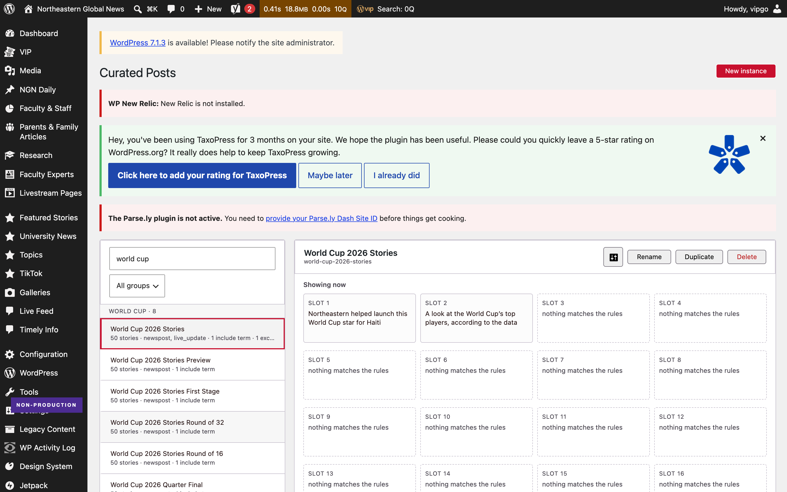

# Before and after — NUEAC-398

The Curated Posts admin screen, before and after the change on branch
`NUEAC-398-curated-posts-admin`
([PR #898](https://github.com/News-at-Northeastern/environment/pull/898)).

Captured with Playwright against the **local VIP dev environment**
(`https://ngn.local.northeastern.edu/wp-admin/admin.php?page=ngn-curated-posts`),
Chromium, 1440 x 900, deviceScaleFactor 2, on 21 October 2026.

---

## The headline

| | Before | After | Change |
| --- | ---: | ---: | ---: |
| **Page height at 1440 wide** | 5,372px | **1,636px** | **-70%** |
| **Screens of scroll at 900px** | 6.0 | **1.8** | -70% |
| Search and group filter | none | **both** | — |
| **Stories a shelf is publishing** | not shown anywhere | **shown, linked, per slot** | — |
| Place in the list after an edit | lost | **held** | index scroll unchanged |
| Settings rows | 8, all always shown | same rows every time, empty ones marked | rotation rows only when it rotates |

The local database holds **14 instances**; production holds **47**. The problems are the
same in kind and smaller in degree here — six screens of scroll instead of roughly forty.
Production figures elsewhere in this repo were read from the live screen and are labelled
as such.

---

## Before

Every instance rendered open, in creation order, with no way to search. Roughly half of
each card is the absence of a setting: rows reading `None`, `N/A` and `Off`.



[Full page](before-02-fullpage-1440.png) — 5,372px tall.

## After — the two-pane workbench

A searchable index on the left that stays put, the selected instance on the right. The
detail pane leads with **what the shelf is publishing right now**, one card per slot,
each linking to the story. The rules that produced them sit below.



This is Direction C from the prototypes, and it is the one design review chose.

### Your place in the list survives an edit

Selecting swaps the right pane only. Verified rather than assumed: the index scroll
offset is identical before and after a selection.



### Filtering



### Why the live stories are affordable here

This nearly did not ship. The index endpoint returns configuration, not stories, and the
codebase already notes in `instance-card.tsx` that *"behind one request per instance on
the page, is seconds"*.

That is a cost of the single-column layout, not of the data. In two panes only the
selected shelf needs stories — **one request on selection, not 47 on load**. Measured at
**1.5s for one instance against a cold cache**, which is fine once and would not have
been fine forty-seven times.

The layout is what makes the feature possible, rather than the feature being blocked by
the layout.

One new endpoint carries it: `GET ngn/v1/curated-posts/<key>/preview`, read-only, editor
permission, wrapping `Curated_Posts::get_wp_posts()` which already existed and is already
covered by the PHP suite.

### Keyboard

Two presses from the search field reach an index row. Rows are `option` elements inside
a `listbox`, so focus is visible, Enter selects, and `aria-selected` reports the state.



---

## How it was verified

Two independent confirmations, plus an accessibility pass.

### 1. Unit tests

```
npx jest --config private/jest.config.js
Tests:       1275 passed, 1275 total
Test Suites: 2 failed, 142 passed, 144 total
```

**Every test passed.** The two failing suites never ran — they cannot resolve
`@observablehq/plot`, which is not installed in this environment (`npm ls
@observablehq/plot` is empty). Both are in `client-mu-plugins/ngn-app`, which this branch
does not touch, so the failure predates the change.

### 2. Driven in a real browser

Page height, card counts, search results, expansion, tab order and `aria-expanded` all
read back from the live DOM with Playwright, at two widths.

| | 1280 | 1440 |
| --- | --- | --- |
| Page height | 1,636px | 1,636px |
| Two columns held | yes | yes |
| Horizontal page scroll | none | none |
| JavaScript errors | none | none |

[1280](c-05-1280.png) · the layout drops to one column below 960px.

### 3. Accessibility

axe-core 4.10.2 against `.ngn-cpa` with `wcag2a, wcag2aa, wcag21a, wcag21aa`, in three
states — default, after selecting, filtered. **No violations in any state**, which covers
colour contrast.

| Keyboard check | Result |
| --- | --- |
| Search reachable and typeable | yes, typing filtered to 8 of 14 |
| Tab reaches an index row | yes, two presses from the search field |
| Focus visible on a row | yes, `outline: solid 2px` |
| Enter selects it | yes, detail pane swapped |
| State exposed to assistive tech | yes, `role="option"` with `aria-selected` |

### Not run

**PHP tests, locally.** `bin/test-php.sh` stops at `env: php: No such file or directory`,
and inside the `ngn-php-1` container `themes/ngn-theme/vendor/autoload.php` is absent, so
Composer dependencies are not installed here. **CI covers this gap: PHPUnit passes on the
branch**, along with Build, Required checks and Test location policy. The branch adds one read-only PHP route; `php -l` is clean and it was exercised live.

**End-to-end visual regression.** `npm run test:e2e` drives the public site's holotype
pages. It does not cover wp-admin.

---

## Self-audit, after the PR was opened

Four defects found by driving the screen rather than re-reading the diff. Each was
reproduced first, then fixed, then re-tested. Fixed in `01fc8ce9e`.

| # | Defect | How it showed up |
| --- | --- | --- |
| 1 | Collapse all tracked its own flag while acting on the filtered list | Expand all under a search, clear the search: the button read "Collapse all" with 1 card of 14 open. The control is gone in two panes, but the bug was real |
| 2 | Creating or duplicating under an active filter | The new instance was filtered straight back out, so the panel closed and nothing appeared |
| 3 | Renaming orphaned the card's expansion | Expansion is keyed by instance key, so the card collapsed under the editor mid-edit and the old key leaked |
| 4 | A long label widened the row instead of truncating | The text column is a flex child, so `min-width` defaulted to `auto` and the ellipsis never engaged |

A fifth suspicion — that the New instance button vanished when nothing matched the
filter — turned out to be a wrong selector in the audit script. The button collapses to
a trigger by default. It is recorded here because it was checked, not assumed.

A fifth, found after the rebuild: WordPress relocates admin notices to just after the
first heading, so with the heading inside a flex row they became flex items and wrecked
the header. Fixed with core's own `wp-header-end` marker.

After the fixes: 1,275 tests still pass, axe reports no violations in all three states,
and there are no console errors through the whole sequence.

### A fifth change, from reviewing it on the real screen

Dropping unset rows entirely left two cards impossible to read against each other: one
showed Exclude terms and the next did not, so the labels stopped lining up and "no
exclusions set" looked the same as "I have not checked". The variation between instances
was always there; hiding the empty rows is what made it visible.

Every card now renders the same six rows and marks the empty ones. This costs height only
on an expanded card:

| | Height |
| --- | ---: |
| Collapsed, the default | **1,659px**, unchanged |
| One card open | 1,917px |
| All fourteen open | 5,022px |
| The old screen, always open | 5,372px |

Even with every card expanded it is shorter than the screen used to be at rest.

---

## Reproducing this

The VIP dev environment must be running (`vip dev-env start --slug ngn`), and the admin
must be loaded over **https**.

Over http every REST call returns 403 and the page shows *"Failed to load instances:
403"*. The login cookie is set for one scheme and the REST URL uses the other, so the
cookie is never sent. This happens on `develop` too — it is an environment quirk, not a
behaviour of this branch.

```bash
vip dev-env list      # take the https LOGIN URL, not the http one
npm --prefix themes/ngn-theme run build:admin
```

Then open `/wp-admin/admin.php?page=ngn-curated-posts` over https.

---

## Where the screen lives

Not a plugin — theme code, and the list is a React app.

```
themes/ngn-theme/
  inc/admin/curated-posts/
    class-curated-posts-admin-page.php           registers the page, enqueues the app
    class-curated-posts-instance-controller.php  REST routes under ngn/v1/curated-posts
  src/scripts/admin/curated-posts-admin/
    app.tsx                                      the list, filter and collapse state
    components/instance-filter.tsx               the toolbar and the grouping rules
    components/instance-card.tsx                 one card, collapsible
    components/create-instance.tsx               the New instance control
    index.scss                                   layout for the toolbar and card header
```

Repo: `News-at-Northeastern/environment`.
