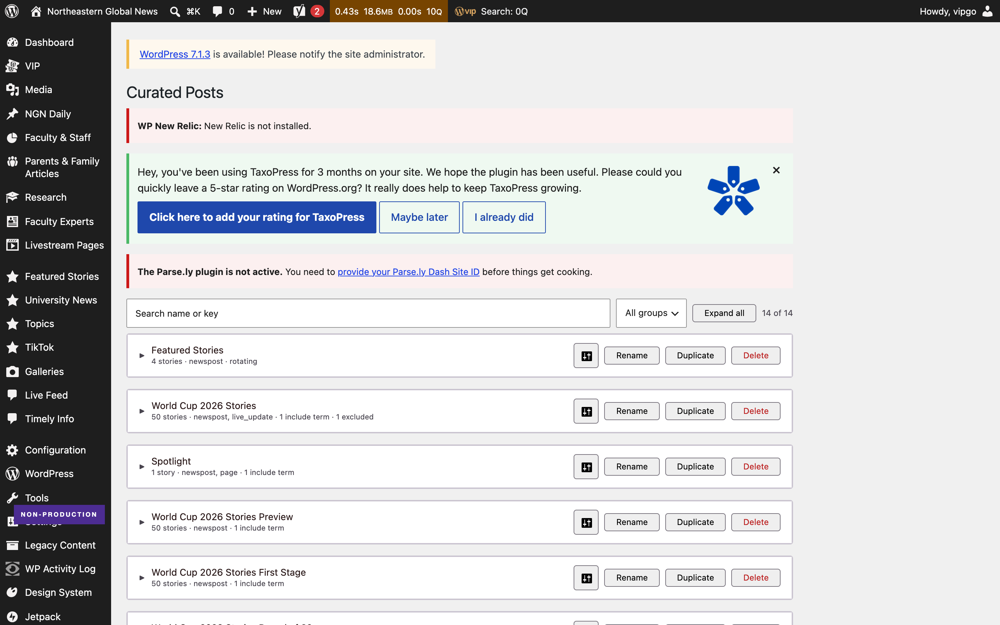
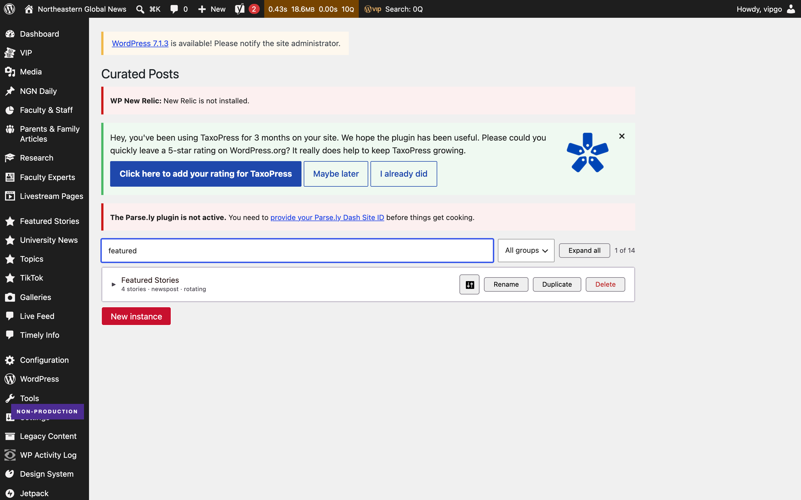
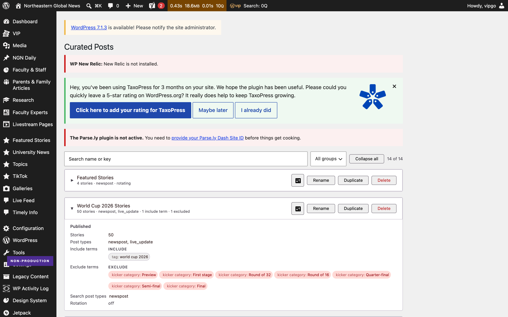
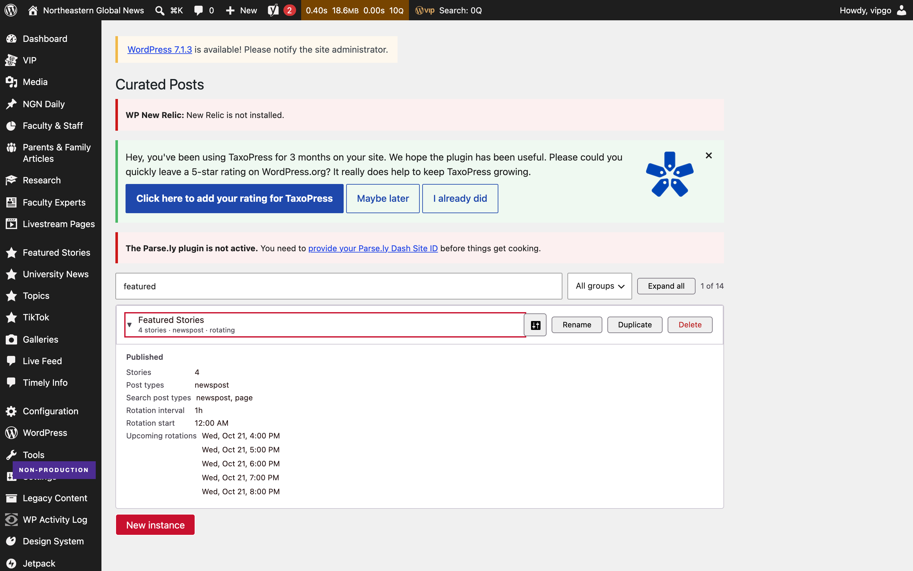

# Before and after — NUEAC-398

The Curated Posts admin screen, before and after the change on branch
`NUEAC-398-curated-posts-admin`
([PR #898](https://github.com/News-at-Northeastern/environment/pull/898)).

Captured with Playwright against the **local VIP dev environment**
(`https://ngn.local.northeastern.edu/wp-admin/admin.php?page=ngn-curated-posts`),
Chromium, 1440 x 900, deviceScaleFactor 2, on 21 October 2026.

---

## The headline

| | Before | After | Change |
| --- | ---: | ---: | ---: |
| **Page height at 1440 wide** | 5,372px | **1,659px** | **-69%** |
| **Screens of scroll at 900px** | 6.0 | **1.8** | -70% |
| Search controls | 0 | **1** | — |
| Group filter | none | **1** | — |
| Visible count | none | "14 of 14" | — |
| Settings rows on an open card | 8, all always shown | **6**, same six every time | rotation rows only when it rotates |
| Rename / Duplicate / Delete | 14 each | 14 each | unchanged |

The local database holds **14 instances**; production holds **47**. The problems are the
same in kind and smaller in degree here — six screens of scroll instead of roughly forty.
Production figures elsewhere in this repo were read from the live screen and are labelled
as such.

---

## Before

Every instance rendered open, in creation order, with no way to search. Roughly half of
each card is the absence of a setting: rows reading `None`, `N/A` and `Off`.


[Full page](before-02-fullpage-1440.png) — 5,372px tall.

## After

A search field, a group filter, a visible count and a collapse-all toggle. Every card
collapsed to its name plus the one line that tells two instances apart: story count,
post types, include terms, and whether it rotates.



[Full page](after-02-fullpage-1440.png) — 1,659px tall.

### Search

Typing `featured` leaves one card. The count reads "1 of 14" and is announced through
`aria-live="polite"`.



### One card opened

Clicking a card header opens that card only.

Every card shows **the same six rows in the same order** — stories, post types, include
terms, exclude terms, search post types, rotation — so two cards read against each other.
A setting holding no value keeps its row and says so in italic rather than disappearing,
because "none set" and "not checked" are different things. Rotation start and upcoming
rotations appear only when rotation is on, since they are meaningless otherwise.


Two cards side by side, labels aligned:



### Keyboard

Tab order runs search, group, collapse all, then the first card header. The header is a
real `button`, so it takes focus, shows a 2px ring, responds to Enter, and reports
`aria-expanded`.



---

## How it was verified

Two independent confirmations, plus an accessibility pass.

### 1. Unit tests

```
npx jest --config private/jest.config.js
Tests:       1275 passed, 1275 total
Test Suites: 2 failed, 142 passed, 144 total
```

**Every test passed.** The two failing suites never ran — they cannot resolve
`@observablehq/plot`, which is not installed in this environment (`npm ls
@observablehq/plot` is empty). Both are in `client-mu-plugins/ngn-app`, which this branch
does not touch, so the failure predates the change.

### 2. Driven in a real browser

Page height, card counts, search results, expansion, tab order and `aria-expanded` all
read back from the live DOM with Playwright, at two widths.

| | 1280 | 1440 |
| --- | --- | --- |
| Page height | 1,659px | 1,659px |
| Horizontal page scroll | none | none |
| Toolbar wraps to a second row | no | no |
| JavaScript errors | none | none |

[1280 viewport](after-05-1280px.png) · [1280 full page](after-05-1280-fullpage.png) · [1440 viewport](after-05-1440px.png)

### 3. Accessibility

axe-core 4.10.2 against `.ngn-cpa` with `wcag2a, wcag2aa, wcag21a, wcag21aa`, in three
states — collapsed, one card expanded, filtered. **No violations in any state**, which
covers colour contrast.

| Keyboard check | Result |
| --- | --- |
| Search reachable and typeable | yes, typing `featured` filtered to 1 card |
| Result count announced | yes, `aria-live="polite"` reads "1 of 14" |
| Tab order reaches a card header | yes: search, group, collapse all, first card |
| Focus visible on the card header | yes, `outline: solid 2px` |
| Enter expands the card | yes, 0 settings blocks to 1 |
| State exposed to assistive tech | yes, `aria-expanded` flips to `true` |

### Not run

**PHP tests.** `bin/test-php.sh` stops at `env: php: No such file or directory`, and
inside the `ngn-php-1` container `themes/ngn-theme/vendor/autoload.php` is absent, so
Composer dependencies are not installed here. The branch changes no PHP: four files, all
`.tsx` and `.scss`.

**End-to-end visual regression.** `npm run test:e2e` drives the public site's holotype
pages. It does not cover wp-admin.

---

## Self-audit, after the PR was opened

Four defects found by driving the screen rather than re-reading the diff. Each was
reproduced first, then fixed, then re-tested. Fixed in `01fc8ce9e`.

| # | Defect | How it showed up |
| --- | --- | --- |
| 1 | Collapse all tracked its own flag while acting on the filtered list | Expand all under a search, clear the search: the button read "Collapse all" with 1 card of 14 open |
| 2 | Creating or duplicating under an active filter | The new instance was filtered straight back out, so the panel closed and nothing appeared |
| 3 | Renaming orphaned the card's expansion | Expansion is keyed by instance key, so the card collapsed under the editor mid-edit and the old key leaked |
| 4 | A long label widened the row instead of truncating | The text column is a flex child, so `min-width` defaulted to `auto` and the ellipsis never engaged |

A fifth suspicion — that the New instance button vanished when nothing matched the
filter — turned out to be a wrong selector in the audit script. The button collapses to
a trigger by default. It is recorded here because it was checked, not assumed.

After the fixes: 1,275 tests still pass, axe still reports no violations in all three
states, a 140-character label no longer grows the page past 1440px, and there are no
console errors through the whole sequence.

### A fifth change, from reviewing it on the real screen

Dropping unset rows entirely left two cards impossible to read against each other: one
showed Exclude terms and the next did not, so the labels stopped lining up and "no
exclusions set" looked the same as "I have not checked". The variation between instances
was always there; hiding the empty rows is what made it visible.

Every card now renders the same six rows and marks the empty ones. This costs height only
on an expanded card:

| | Height |
| --- | ---: |
| Collapsed, the default | **1,659px**, unchanged |
| One card open | 1,917px |
| All fourteen open | 5,022px |
| The old screen, always open | 5,372px |

Even with every card expanded it is shorter than the screen used to be at rest.

---

## Reproducing this

The VIP dev environment must be running (`vip dev-env start --slug ngn`), and the admin
must be loaded over **https**.

Over http every REST call returns 403 and the page shows *"Failed to load instances:
403"*. The login cookie is set for one scheme and the REST URL uses the other, so the
cookie is never sent. This happens on `develop` too — it is an environment quirk, not a
behaviour of this branch.

```bash
vip dev-env list      # take the https LOGIN URL, not the http one
npm --prefix themes/ngn-theme run build:admin
```

Then open `/wp-admin/admin.php?page=ngn-curated-posts` over https.

---

## Where the screen lives

Not a plugin — theme code, and the list is a React app.

```
themes/ngn-theme/
  inc/admin/curated-posts/
    class-curated-posts-admin-page.php           registers the page, enqueues the app
    class-curated-posts-instance-controller.php  REST routes under ngn/v1/curated-posts
  src/scripts/admin/curated-posts-admin/
    app.tsx                                      the list, filter and collapse state
    components/instance-filter.tsx               the toolbar and the grouping rules
    components/instance-card.tsx                 one card, collapsible
    components/create-instance.tsx               the New instance control
    index.scss                                   layout for the toolbar and card header
```

Repo: `News-at-Northeastern/environment`.
